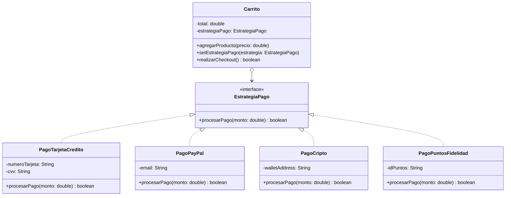

# Patrón de Diseño: Strategy

El patrón **Strategy** es un patrón de comportamiento que permite **definir una familia de algoritmos**, colocar cada uno de ellos en una clase independiente y hacer que sus objetos sean **intercambiables** en tiempo de ejecución.

## 1. El Problema

En un sistema de comercio electrónico, los clientes pueden finalizar sus compras pagando a través de múltiples canales (tarjeta de crédito, PayPal, criptomonedas, puntos de fidelidad, etc.).

Si el cálculo y la ejecución del pago se programan directamente dentro de la clase principal `Carrito` mediante condicionales (`if/else` o `switch` seguidos por tipo de pago):

* **Violación de principios SOLID:** La clase `Carrito` asume responsabilidades que no le corresponden, acoplándose a las API externas y lógica de validación de cada pasarela.
* **Código rígido y propenso a errores:** Cada vez que se agrega o modifica un método de pago, hay que modificar la clase `Carrito`, arriesgándose a romper los métodos de pago existentes.
* **Atributos innecesarios:** La clase `Carrito` se llena de campos ambiguos (como `numeroTarjeta`, `cvv`, `emailPayPal`, `walletAddress`), muchos de los cuales quedarán vacíos o en `null` según el método elegido.

---

## 2. La Solución

El patrón **Strategy** sugiere extraer cada método de pago a su propia clase independiente que implemente una interfaz común (`EstrategiaPago`).

* **Interfaz común:** Declara la operación `procesarPago(monto)`.
* **Estrategias concretas:** Cada clase (`PagoTarjetaCredito`, `PagoPayPal`, `PagoCripto`, `PagoPuntosFidelidad`) implementa la interfaz y mantiene en sus propios campos solo la información que necesita para operar.
* **Contexto desacoplado:** La clase `Carrito` guarda una referencia a la interfaz `EstrategiaPago`. En lugar de ejecutar la lógica de pago directamente, le **delega** la tarea a la estrategia configurada.
* **Cambio dinámico:** El cliente puede cambiar la estrategia de pago en tiempo de ejecución (`setEstrategiaPago`) antes de realizar el *checkout*.

---

## 3. Estructura de la Solución



---

## 4. Código en Java

```java
// EstrategiaPago.java
// INTERFAZ ESTRATEGIA: Contrato comun para todos los metodos de pago.
public interface EstrategiaPago {
    boolean procesarPago(double monto);
}
```

```java
// PagoTarjetaCredito.java
// ESTRATEGIA CONCRETA 1: Maneja los datos y logica especificos de tarjetas.
public class PagoTarjetaCredito implements EstrategiaPago {

    private final String numeroTarjeta;
    private final String cvv;

    public PagoTarjetaCredito(String numeroTarjeta, String cvv) {
        this.numeroTarjeta = numeroTarjeta;
        this.cvv = cvv;
    }

    @Override
    public boolean procesarPago(double monto) {
        String ultimosDigitos = numeroTarjeta.substring(numeroTarjeta.length() - 4);
        System.out.println("  [Tarjeta] Cobrando $" + monto + " a la tarjeta ****" + ultimosDigitos);
        return true;
    }
}
```

```java
// PagoPayPal.java
// ESTRATEGIA CONCRETA 2: Maneja la autenticacion y cobro por PayPal.
public class PagoPayPal implements EstrategiaPago {

    private final String email;

    public PagoPayPal(String email) {
        this.email = email;
    }

    @Override
    public boolean procesarPago(double monto) {
        System.out.println("  [PayPal] Redirigiendo a pasarela para cobrar $" + monto + " a " + email);
        return true;
    }
}
```

```java
// PagoCripto.java
// ESTRATEGIA CONCRETA 3: Transaccion en blockchain mediante billetera digital.
public class PagoCripto implements EstrategiaPago {

    private final String walletAddress;

    public PagoCripto(String walletAddress) {
        this.walletAddress = walletAddress;
    }

    @Override
    public boolean procesarPago(double monto) {
        String walletCorta = walletAddress.substring(0, 6);
        System.out.println("  [Cripto] Generando QR para $" + monto + " USD hacia la billetera " + walletCorta + "...");
        return true;
    }
}
```

```java
// PagoPuntosFidelidad.java
// ESTRATEGIA CONCRETA 4: Canje de puntos acumulados por el usuario.
public class PagoPuntosFidelidad implements EstrategiaPago {

    private final String idPuntos;

    public PagoPuntosFidelidad(String idPuntos) {
        this.idPuntos = idPuntos;
    }

    @Override
    public boolean procesarPago(double monto) {
        System.out.println("  [Puntos] Canjeando " + monto + " puntos de fidelidad de la cuenta " + idPuntos + ".");
        return true;
    }
}
```

```java
// Carrito.java
// CONTEXTO: No sabe COMO funciona cada pasarela de pago; solo invoca la estrategia configurada.
public class Carrito {

    private double total = 0;
    private EstrategiaPago estrategiaPago;

    public void agregarProducto(double precio) {
        this.total += precio;
    }

    // Permite cambiar la estrategia de pago dinamicamente en tiempo de ejecucion
    public void setEstrategiaPago(EstrategiaPago estrategiaPago) {
        this.estrategiaPago = estrategiaPago;
    }

    public boolean realizarCheckout() {
        if (estrategiaPago == null) {
            System.out.println("  Error: Debe seleccionar un metodo de pago antes de procesar la compra.");
            return false;
        }
        System.out.println("Iniciando pago por un total de $" + total + "...");
        return estrategiaPago.procesarPago(total);
    }
}
```

```java
// App.java
// CLIENTE: Configura el contexto y selecciona la estrategia deseada mediante clases concretas.
public class App {
    public static void main(String[] args) {
        Carrito carrito = new Carrito();
        carrito.agregarProducto(150.0);
        carrito.agregarProducto(49.99);

        // 1. Pago con Tarjeta de Crédito
        carrito.setEstrategiaPago(new PagoTarjetaCredito("4532890123456789", "123"));
        carrito.realizarCheckout();

        System.out.println("---");

        // 2. Cambio de opinión en el checkout: Pago con PayPal
        carrito.setEstrategiaPago(new PagoPayPal("usuario@email.com"));
        carrito.realizarCheckout();

        System.out.println("---");

        // 3. Pago con Criptomonedas
        carrito.setEstrategiaPago(new PagoCripto("0x71C7656EC7ab88b098defB751B7401B5f6d8976F"));
        carrito.realizarCheckout();

        System.out.println("---");

        // 4. Pago con Puntos de Fidelidad (Clase concreta tradicional)
        carrito.setEstrategiaPago(new PagoPuntosFidelidad("VIP-98765"));
        carrito.realizarCheckout();
    }
}
```

---

## 5. Salida Esperada

```text
Iniciando pago por un total de $199.99...
  [Tarjeta] Cobrando $199.99 a la tarjeta ****6789
---
Iniciando pago por un total de $199.99...
  [PayPal] Redirigiendo a pasarela para cobrar $199.99 a usuario@email.com
---
Iniciando pago por un total de $199.99...
  [Cripto] Generando QR para $199.99 USD hacia la billetera 0x71C7...
---
Iniciando pago por un total de $199.99...
  [Puntos] Canjeando 199.99 puntos de fidelidad de la cuenta VIP-98765.
```